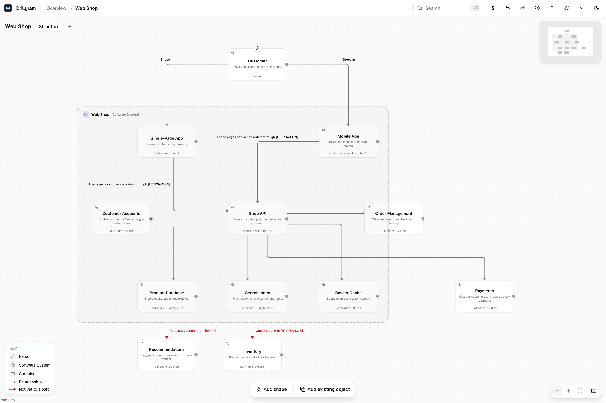

# Drillgram

Architecture diagrams you can drill into.

A design tool for **product engineers**: draw software architecture as boxes that open into
deeper diagrams, and export them as pictures or as text. It runs in the browser and keeps its
data there.



## What it does

- **Boxes that open**: every box holds a diagram of its own. Open it to see its parts, go back
  with the breadcrumb. A connection of a part also shows one level up.
- **Shapes**: C4's Person, Software System, Container, Component and Code, a plain box, 46
  flowchart outlines and tables.
- **Layout**: connectors run around the cards, a dragged card snaps to a free place, and
  "Arrange" lays out the whole diagram.
- **Undo, redo and a timeline**: every change is logged with its time. Step back and forth, or
  drag the timeline to see the diagram as it was. The log survives a reload.
- **Import and export**: SVG, PNG, Mermaid and D2 out; Mermaid (C4 and flowcharts) and D2 in.

## Not built yet

- **MCP server**: agents read, create and change diagrams through MCP tools.
- **Working together**: several people on one diagram, comments, a backend that keeps
  workspaces.
- **More export formats**, decided in issues. iOS and Android apps may follow the web app.

## Run it

Needs [mise](https://mise.jdx.dev) and git.

```sh
git clone --recurse-submodules https://github.com/mafigit/drillgram.git
cd drillgram
mise install
pnpm install
pnpm --filter @drillgram/web dev
```

Then open `http://localhost:5173` and choose "Load an example". The app needs no network and
no account. More commands: [context/operations.md](context/operations.md).

## What is where

| Folder | What |
| --- | --- |
| `apps/web` | The app: Vue 3, Vite, TypeScript, the canvas on Vue Flow. Journey tests in `e2e/`. |
| `packages/model` | Boxes, connections, views and the file formats. No Vue. |
| `packages/layout` | The layout engine: Rust, compiled to WebAssembly. A git submodule. |
| `docs/journeys.md` | What a user can do, each with an end-to-end test. |
| `context/` | What the app does now and how it is built. |

## How it gets built

The design lives in the project's issues.
Development is **test-driven first**: tests come before code, in every PR, with end-to-end
browser tests for everything a user can see.
Each issue is built in a pull request of its own.

See [AGENTS.md](AGENTS.md) for the rules agents follow.

## Licence

[Apache-2.0](LICENSE). Some parts are under other terms, listed in [NOTICE](NOTICE): the layout
engine in `packages/layout` (MPL-2.0), the icons a card can carry (each its own licence, see
[docs/icon-licences.md](docs/icon-licences.md)), the components generated by shadcn-vue (MIT)
and the Geist font (OFL-1.1). `REUSE.toml` says it for every file, and the full check holds
every file, npm package and crate against a list ([docs/agents/licences.md](docs/agents/licences.md)).
